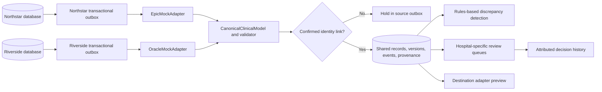
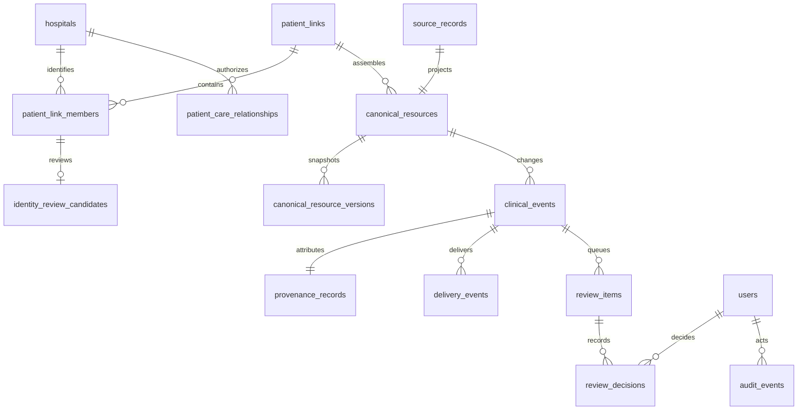

# Architecture and data boundaries

## Clinical workspace extension (migration 0002)

The original Next.js/FastAPI/three-store architecture below is retained. The frontend now has only Overview, Patients, and Clinical Review as global clinical sections. Each hospital uses the same components. Clinical overview, shared records, vaccinations, notes, and timelines are scoped to a selected local patient, with the hospital included in its URL and request context.

`hospital_memberships` associates a user, hospital, active flag, and workspace-specific role. A session stores `active_hospital_id`; switching validates membership server-side and never changes the primary user record. Requests carry `X-Workspace-ID`; stale contexts are rejected, and multi-hospital accounts must supply it for mutations. Existing users gain only their original primary membership during migration; explicit synthetic fixtures grant the network clinician and administrator their second memberships.

Patient registration adds first/last name, administrative gender, optional contact, care status, and creation/update timestamps to each local `patients` table. It creates an explicit local care relationship and standalone shared identity without merging another person. Match suggestions disclose only permitted identity metadata: current-hospital patients, or another workspace where the same user has membership and the hospital has a care relationship. An explicit reviewed match token is required when similarities exist. Cross-store registration is not a distributed transaction; production crash-recovery/compensation is a future requirement.

New `patient_timeline_events` preserve registration, imported-chart context, and note approvals locally. Patient-specific timeline queries combine these with immutable local versions, authorized external clinical events, current-hospital review decisions, and discrepancy review decisions. Local and external source events are not indiscriminately duplicated; the receiving date is distinguished from the clinical date and source occurrence time. Draft notes do not appear as finalized clinical information.

New `clinical_note_drafts` are local to a hospital and private to their author. They hold a revision, title, source transcript/expiry, editable SOAP sections, provider/warnings, draft/approval state, author/approval metadata, and final local record reference. Generation cannot create clinical records. Explicit approval atomically reserves a fresh revision, creates one approved `DocumentReference` source record/version/outbox event, and appends a note-approval timeline event in the same local transaction. Repeated approval is idempotent. The raw transcript has configurable expiry; audio is never persisted. [PROVIDERS.md](PROVIDERS.md) documents provider interfaces, external authorization, and retention boundaries.

New `conflict_reviews` are projections per difference/hospital, with immutable `conflict_review_decisions`. They track Needs review, Under investigation, or Resolved for that hospital. The reviewed clinical fingerprint is retained; if source differences change, the previous decision no longer hides the new difference. A review never rewrites either source or establishes a correct dose. Vaccination duplicate detection retains both source records and excludes unrelated administration dates from contradictory-status rules.

Identity candidates can now reference a separate target patient identity. Requesting a link does not change either identity. Confirmation requires administrator review and refuses to reassign already-published independent global histories. Rejection preserves an existing standalone local identity and its history. Full identity-alias/history reconciliation remains future work.

Migration `0002` is additive, preserves existing data/sessions/passwords/source history, and creates the additional tables and indexes in the correct store. A downgrade deliberately requires restoring a verified backup rather than deleting clinical-note evidence.

### Additional hospitals through configuration

`HOSPITAL_CONFIG_JSON` accepts additional local database definitions and explicit membership grants. For example, set this process environment value before using the local launcher (use forward slashes in SQLite paths on Windows):

```json
{
  "harbor": {
    "name": "Harbor Community Hospital",
    "adapter": "epic-mock",
    "database_url": "sqlite:///.data/clinicalsync_harbor.db",
    "memberships": {"network@clinicalsync.demo": "clinician"}
  }
}
```

The database factory and adapter registry add this source; the migration CLI applies its local schema, and hospital metadata/memberships are seeded idempotently. The same frontend selector, directory, chart, review, note, and synchronization code is used. No patient-care relationships are inferred for an additional hospital. The automated integration suite verifies switching into a configured third workspace, registering its own patient, creating a source entry, and publishing through the existing engine. This checks scalability without adding a third frontend or a new clinical demonstration scenario.

The existing mock adapter kinds are `epic-mock` and `oracle-mock`; a genuinely different integration must implement/register its source adapter. Real vendor authentication/network integration is not included. Additional Compose stores require an explicit Compose override/service/environment configuration. Demo reset refuses any configuration with additional stores so it cannot accidentally recreate them.

### New REST endpoints

| Endpoint | Responsibility |
| --- | --- |
| `POST /api/auth/workspace` | Select an authorized session workspace |
| `GET /api/directory`, `/api/overview` | Clinical directory groups and hospital attention summary |
| `POST /api/local/patients/check-matches` | Authorized demographic suggestions and review token |
| `POST /api/local/patients` | Explicit local registration, care relationship, standalone identity |
| `GET /api/charts/{local_id}`, `/timeline` | Current local + authorized external context and independent history |
| `GET /api/local/records/{id}/details` | Local source history, including unsynchronized source versions |
| `GET /api/notes/config` | Non-secret provider capability and retention information |
| `POST /api/local/patients/{id}/recording-events` | Patient-authorized recording-consent/lifecycle audit metadata; no audio payload |
| `GET/POST /api/local/patients/{id}/note-drafts` | Author-private draft retrieval and creation |
| `PUT /api/note-drafts/{id}` | Revision-protected draft editing |
| `POST /api/note-drafts/{id}/generate` | Provider organization of a saved unapproved draft |
| `POST /api/note-drafts/{id}/approve` | Explicit clinician approval and local document/outbox transaction |
| `POST /api/local/patients/{id}/transcriptions` | Authorized, size-bounded audio request; no server audio storage |
| `POST /api/conflicts/{id}/reviews` | Hospital-specific difference review and immutable decision |
| `GET /api/identity/targets`, `POST /api/identity/link-requests` | Administrator identity metadata/search and separate review request |

All relevant endpoints enforce active membership, hospital boundaries, care relationships, and confirmed identity/sharing eligibility. Existing API families below remain available, including source payloads, provenance, history, comparisons, incoming review decisions, synchronization failures, and audit activity.

ClinicalSync is a modular monolith with a Next.js client and FastAPI API. The backend is the only process holding all three database connections. Hospital-scoped routes select one local session factory from the authenticated user’s hospital; request bodies cannot select a hospital. Each local database has independent patients, clinical records, immutable versions, users, and transactional outbox events.



Neither `DEC` nor `PRE` writes to a hospital chart. A third source needs an adapter implementing `unpack`, `pack`, `to_canonical`, and `from_canonical`, its own database connection, and hospital/identity fixtures. No direct Epic-to-Oracle transformation exists.

## Relational model

Local tables exist in both hospital stores:

| Table | Responsibility |
| --- | --- |
| `patients` | Synthetic identities with original local IDs |
| `local_users` | Hospital-associated fixture authors |
| `clinical_records` | Mutable current source projection; version used for compare-and-swap |
| `clinical_record_versions` | Immutable source snapshots, author, date, and event kind |
| `outbox_events` | Same-transaction snapshots awaiting shared publication; state and retries |

Shared tables:

| Table | Responsibility |
| --- | --- |
| `hospitals`, `users`, `sessions` | Hospital context, hashed passwords, hashed opaque sessions |
| `patient_links` | Global synthetic patient identity |
| `patient_link_members` | Original local identity, confirmation state, evidence, reviewer |
| `identity_review_candidates` | Ambiguous identity workflow, decision and evidence note |
| `patient_care_relationships` | Explicit hospital/local-patient authorization |
| `source_records` | Stable hospital + original source-record identity and latest observed version |
| `canonical_resources` | Mutable source-linked canonical projection; sources stay separate |
| `canonical_resource_versions` | Immutable canonical and original snapshots with mapping reports |
| `clinical_events` | Append-only changes with parent, snapshots, source version, semantic diff, lineage and fingerprint |
| `provenance_records` | FHIR-style provenance linked one-to-one to an event |
| `synchronization_jobs` | Attempts, timestamps, published/suppressed/failed/held counts |
| `delivery_events` | Transport delivery to a specific eligible hospital |
| `review_items` | Hospital-specific clinical status and optimistic revision |
| `review_decisions` | Immutable attributed decisions and notes |
| `clinical_conflicts` | Deterministic discrepancy identity, involved records and field differences |
| `audit_events` | Attributable access, modification, and denied-request references |



Foreign keys protect relational references. Unique constraints protect local record/version pairs, shared hospital/source/version event identity, stable source identities, per-event/per-hospital deliveries and review items, per-resource canonical versions, and per-hospital local identity membership. Patient, source, event, date, and review lookup columns are indexed. The shared current view can be rebuilt by selecting each source’s latest canonical version and retaining event/provenance history; it is not a merged clinical truth.

## Source mutation and synchronization

1. Authenticate the hospital clinician. Verify a care relationship to the local patient.
2. Validate input and deterministic translation. Atomically compare the expected source version to the current row.
3. In one local transaction, update the projection, append a historical source snapshot, and insert an outbox snapshot. Outbox state starts `PENDING`.
4. The explicit worker processes pending, failed, and identity-held snapshots in source-version order. A failed version blocks later versions of that record in the same run.
5. Require a confirmed source identity. Unconfirmed records stay `WAITING_IDENTITY` in their own database. They are absent from shared records and receiving review queues.
6. Check event ID, source version, and origin lineage. Existing publications are suppressed; imported lineage referencing an existing clinical event is suppressed.
7. Translate and validate. In one shared transaction, update the current source projection, append canonical snapshot/event/provenance, create eligible delivery/review rows, and refresh discrepancy projections.
8. Commit shared publication, then acknowledge the local outbox. If acknowledgement is interrupted, a retry sees the existing shared identity and cannot duplicate publication.
9. Persist the job result. Only `SUCCEEDED` advances the last fully successful source synchronization timestamp. A held identity causes explicit partial coverage; failures remain failures. Last observed source timestamps and pending/failed/held counts are reported separately.

The MVP uses no distributed transaction. Recovery rests on a durable local outbox plus uniqueness in shared transactions. Concurrent workers can contend on uniqueness; the failed attempt remains retryable. There are no multi-worker leases or automatic retry schedules yet. The UI and CLI use an explicit worker, which is sufficient for the demo.

## Clinical events and decisions

Events support `CREATED`, `UPDATED`, `CORRECTED`, and `WITHDRAWN`. Corrections append a new source version; withdrawals append a version with an inactive/stopped/cancelled representation and retain history. Source fields are compared deterministically; JSON key order and retrieval do not create changes. Metadata-only source update requests do not create a new source version when the clinical payload is unchanged.

The event stores original source identity, local patient reference via the source record, global patient link, resource type and ID, prior/current snapshots, parent event, source author and occurrence time, ingestion time, transformation version, correlation ID, origin lineage, and a deterministic semantic fingerprint. The source record ID plus source version is the authority for delivery idempotency; equal fingerprints never erase independent provenance.

Transport states are `PENDING`, `PUBLISHED`, `SUPPRESSED`, `FAILED`, or `WAITING_IDENTITY` in the source outbox and `DELIVERED` in the shared delivery ledger. Clinical review states are separately `PENDING_REVIEW`, `ACCEPTED`, `DEFERRED`, `REJECTED`, and `INVESTIGATING`. Every decision appends an author/time/note snapshot and advances the review item’s revision with an atomic compare-and-swap. No decision mutates external information or any local EHR record.

## Rules and matching

Rules require matching coding system/code for medication and lab comparisons; unrelated medicines do not conflict. Medication doses/frequencies require overlapping effective periods and active statuses. Lab discrepancies require the same collection time. Explicit demonstration `NO_KNOWN_ALLERGIES` can differ from an active allergy assertion; an absent record never counts as a negative assertion. Contradictory statuses in overlapping source facts are potential discrepancies. Equivalent clinical fields are labeled `CLINICALLY_EQUIVALENT` with both records preserved. Resolved projections become inactive; previous events still retain the original claims.

Pending and rejected identity members cannot publish or authorize shared access. Administrators must provide a note to confirm/reject candidates. Confirming a candidate retries its source outbox and backfills eligible historical deliveries. A seeded care relationship is still required; confirmation alone never grants all-hospital browsing.

## Migration and operation

`python -m backend.app.cli migrate` invokes Alembic for `shared`, `northstar`, and `riverside`. Each database has its own `alembic_version`. Revision `0001` reconstructs a checked-in JSON schema snapshot, so later Python model edits cannot change the meaning of the initial migration. New schema changes require a new revision. Application startup also calls `create_all` as a convenience for isolated tests and demo reset; normal launchers apply migrations first.

Historical model updates/deletes are rejected by SQLAlchemy listeners. This protects normal application operations, not privileged direct SQL. Direct database access, concurrent reset, background scheduling, production secret management, and durable audit storage require further controls before real-world use.
