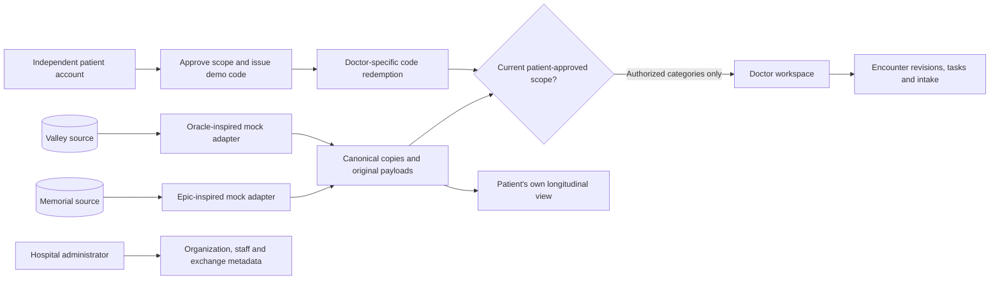

# EHR Bridge architecture

## Application and source boundaries

The Next.js client has a four-page doctor shell, an independent patient shell, and a compact hospital administration shell. TypeScript components under `frontend/src/components/bridge` share accessible Radix dialog primitives, consistent forms, Lucide icons, Recharts charts, and restrained Framer Motion transitions. The existing ClinicalSync application is retained under `/legacy`.

FastAPI owns authentication, authorization, workflow services, and all database connections. SQLAlchemy/Alembic are retained from the working repository; Prisma is not added as a second persistence layer. SQLite provides runnable local persistence. Compose defines separate PostgreSQL stores but requires execution on a Docker-capable host to verify the container path.

Memorial and Valley use separate source databases and separate configured mock adapters. Northstar and Riverside's prior data remains in its original stores. The shared database stores patient identity links, canonical copies, history, consent grants, workflow state, and audit metadata. No application action silently overwrites an external EHR or receiving source chart.

## Permission model

Every request resolves an HTTP-only session, active hospital membership, and workspace-specific role. Mutations enforce CSRF and configured origins. Explicit workspace headers prevent stale tabs from writing under a newly switched hospital. Staff deactivation/role updates apply to existing sessions on their next request.

Doctors require an existing local care relationship and confirmed local identity to discover a Bridge patient. They see local source records under that hospital's ordinary authorization. Connected hospital names/identifiers are permitted identity metadata; they disclose no outside diagnosis, medication, result, document text, or other protected clinical values.

External reads additionally require an unexpired, unrevoked grant matching **patient, doctor, active hospital, source organization, and record category**. The same `record_views`/`patient_scope` boundary controls patient charts, clinical history, translation inspection, and external record reviews. Discrepancies are returned only if all contributing records are visible. Revealing that an unseen medication differs would itself leak clinical information, so such discrepancies are hidden before approval.

Bridge accounts cannot call legacy chart, source, identity, review, or operational APIs to bypass these checks. Legacy identity tools cannot reassign Bridge identities or discover them as link targets. Preserved legacy accounts do not acquire Bridge patient authorization by knowing an ID.

Patient identities are separate from hospital staff memberships. Sarah's account is linked to one global patient identity. Patient endpoints derive/check that link on the server. Another patient's ID yields 404. Administrators can manage only their active organization, and receive organization/exchange/audit metadata rather than patient clinical payloads or encounter intake. Administrative privilege alone never authorizes the clinical read endpoints.

## Approval and one-time codes

An immutable request scope captures sources, categories, purpose, encounter reason, duration (1–24 hours), requesting clinician, organization, and patient. Requests expire after 24 hours. Patient actions support approval, denial, investigation/questions, code replacement, and revocation.

Approval produces a random six-digit **demo** code with a five-minute lifetime. Only a salted scrypt hash is persisted. The plaintext is returned once to the patient; it is not in request lists, audit logs, browser local storage, or doctor endpoints. Generating another code invalidates the old code. This implementation sends no SMS or email.

Redemption checks request ownership, hospital, patient authorization, approval state, expiry, attempt count, and the hash. Invalid attempts commit before returning an error so transaction rollback cannot reset the attempt limit. Five invalid attempts require a new patient-issued code. Compare-and-swap updates reserve the approval state and code; a unique grant-per-request constraint prevents replay. The code cannot be redeemed by another doctor, in another hospital, after expiry, after revocation, or twice.

An activated grant lasts for the approved duration and stores the exact approved source/category scope. Revocation invalidates future external record/history/translation reads. It does not erase original sources, immutable exchange evidence, or the fact that a clinician already reviewed and documented information. SQLite remains a demo persistence implementation; PostgreSQL concurrency/runtime behavior needs integration validation before deployment.

## Models and migration

Migration `0003_ehr_bridge.py` uses a frozen `0003_schema.json` snapshot and creates sixteen additional shared tables. Local source stores retain the existing local patient/clinical record/version/outbox schema. Migration downgrade refuses to destroy consent or clinical evidence; restore a verified backup instead.

| Table/model | Purpose |
| --- | --- |
| `bridge_ehr_connections` / EHRConnection | Hospital/vendor mock adapter, connection state, department, supported destination categories |
| `bridge_patients` / BridgePatient | Global patient, independent portal account, voluntary/unknown demographic fields |
| `bridge_preserved_records` / PreservedRecord | Normalized supplemental facts, original payload, source, author, verification and time |
| `bridge_preserved_versions` / PreservedVersion | Append-only supplemental snapshots |
| `bridge_encounters` / EncounterSession | Doctor/hospital/patient-specific session state, reason, intake, optimistic revision |
| `bridge_encounter_versions` / EncounterVersion | Append-only intake/status/reason snapshots |
| `bridge_session_tasks` / SessionTask | Documentation, record review, missing information, approval, insurance and follow-up work |
| `bridge_voice_memos` / VoiceMemo | Attributable transcript/source/suggestion snapshot; no audio persistence |
| `bridge_intake_questions`, `bridge_intake_answers` | Typed question definitions and patient-reported response evidence |
| `bridge_access_requests` / AccessRequest | Patient-readable scope and decision state |
| `bridge_one_time_codes` / OneTimeCode | Salted code hash, expiry, attempts and use timestamp |
| `bridge_access_grants` / AccessGrant | Activated doctor/hospital/source/category scope and revocation |
| `bridge_exchange_events` / ExchangeEvent | Append-only transformation, workspace availability, preserved fields and related version |
| `bridge_record_reviews` / BridgeRecordReview | Append-only clinical review/flag comments and author/hospital context |
| `bridge_insurance_verifications` / InsuranceVerification | Append-only mock request inputs, sample benefits, source and timestamp |

Existing Hospital, User, HospitalMembership, PatientLink, LinkMember, CareRelationship, CanonicalResource, SourceRecord, LocalRecord/LocalVersion, ResourceVersion, ClinicalEvent, Provenance, OutboxEvent, and AuditEvent continue to represent the underlying source and identity engine.

## Translation and preservation

The original six-category canonical pipeline remains in use for medication statements, allergies, conditions, observations, vaccinations/recommendations, and approved documents. Original source payloads, append-only versions, transformation warnings, and provenance remain available. Mock vendor field names are not represented as official Epic or Oracle interface definitions.

Supplemental blood group, measured observations, history/encounters, and imaging use explicitly internal normalized objects with FHIR-inspired concept names. These supplemental objects are not certified FHIR resources. Both original and normalized representations are retained. Destination support is an explicit mock capability; unsupported content remains **Preserved — not mapped to destination**. The normalized fact survives regardless of the selected destination's mapping.

The inspector shows readable source/internal/destination columns, optional technical representations, selectable versions, side-by-side changed fields, event author/source/time, review comments, and discrepancy flags. It offers no destructive rollback. Enabling a mock destination category makes its preview available without changing source evidence or broadening patient consent.

Exchange evidence distinguishes `TRANSFORMED` from `PRESERVED_UNMAPPED`, and **available in the authorized workspace** from external EHR delivery/acceptance. No external import is attempted. An incomplete destination mapping remains an attention item rather than a falsely successful EHR delivery.

## Session, voice, and insurance behavior

The seven-step New Session dialog saves drafts between steps. Session updates use an expected revision and append immutable snapshots. Returning after a role switch can resume the saved encounter. Sessions cannot change patients or modify an already-completed session. A session cannot complete while tasks remain incomplete. Pending patient-approval work cannot be marked complete until an approval is activated or a definitive patient decision exists.

Custom questions support text, yes/no, multiple-choice, and numeric answers. The backend validates response types and preserves them as doctor-entered patient reports. Patient-reported symptoms, rule-extracted suggestions, measured source observations, imported reports, and verified fictional laboratory values have distinct source labels. No intake submission modifies a medication, allergy, diagnosis, or external source list.

Browser recording uses `getUserMedia`/`MediaRecorder`, real start/pause/resume/stop/cancel controls, playback, and consent. Each capture owns its stream and generation guard, so a delayed permission response cannot stop or populate a later capture. Tracks stop on cancellation/unmount. Raw audio is never stored server-side. Configured external transcription uses the retained authorized upload/provider path. With no credentials, the explicitly labeled sample transcript is fictional and is never substituted for the audio as if it were recognized speech.

Local extractive demo rules suggest only recognized text already in the transcript. Suggestions remain draft until accepted/rejected, and edits reset their review state. Accepted suggestions remain **patient-reported**, not verified source facts. Saved Bridge transcripts are part of demonstration session/voice history and do not inherit the separate legacy draft raw-transcript expiry policy.

The insurance service stores the supplied fictional plan and four sample service responses. Every result identifies its mock source and time, and explicitly denies verification or guaranteed payment. Running the mock does not independently certify coverage or complete the doctor's administrative review task.

## API inventory

All paths below start with `/api/bridge`; request/response schemas are available in FastAPI `/docs`.

| Endpoints | Scope |
| --- | --- |
| `GET /connection` | Active hospital's non-secret mock connection state and capabilities |
| `GET /dashboard` | Current doctor's persisted operational metrics, charts, work queue |
| `GET/POST /patients` | Authorized directory / explicit fictional local registration and duplicate review |
| `GET /patients/{id}` | Scoped clinical sources, provenance summaries, and visible discrepancies |
| `GET /records/{id}` | Current-scope source, normalized/destination representations, versions and events |
| `POST /records/{id}/reviews` | Attributable review/flag with preserved source data |
| `GET/POST /requests` | Own doctor or own patient requests / clinician-created scope |
| `POST /requests/{id}/decision` | Independent patient decision, new code, investigation or revocation |
| `POST /requests/{id}/redeem` | Requesting doctor/hospital single-use code activation |
| `GET/POST /sessions`, `PUT /sessions/{id}` | Own encounter list/create/revision-protected save/complete |
| `POST /sessions/{id}/tasks`, `PUT /tasks/{id}` | Own session task creation and state transitions |
| `POST /intake/extract` | Explicit local draft extraction from supplied source text |
| `POST /sessions/{id}/insurance` | Persisted, labeled mock administrative investigation |
| `GET /exchange` | Patient-authorized record choices and the doctor's own exchange metadata |
| `GET /patient-home` | Signed-in patient's own records, requests and access history |
| `GET /admin` | Organization-only connection, staff, exchange and audit metadata |
| `PUT /admin/connection` | Own mock configuration and supported destination categories |
| `POST /admin/staff`, `PUT /admin/staff/{membership}` | Own organization staff creation and membership changes |

Authentication uses the existing `/api/auth/login`, `/me`, `/workspace`, and `/logout`. Recording-consent/lifecycle audit and authorized transcription use the retained patient-local capture endpoints. Other legacy clinical APIs are unavailable to Bridge accounts.

## Deliberate limits

No live SMART on FHIR vendor/payer connection, external EHR write-back, SMS, enterprise identity/MFA, emergency override, production encryption/key management, distributed transaction, independent clinical validation, full FHIR conformance, or HIPAA certification is claimed. SQLite/process-local services and ORM append-only guards are suitable only for the fictional demonstration. Real deployment requires a validated security, legal, operational, retention, accessibility, clinical-usability, and vendor-integration program.
